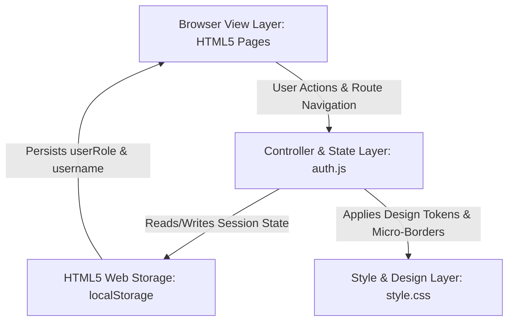
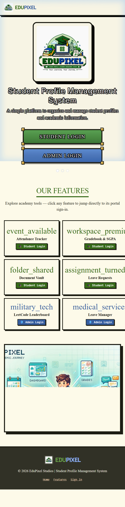
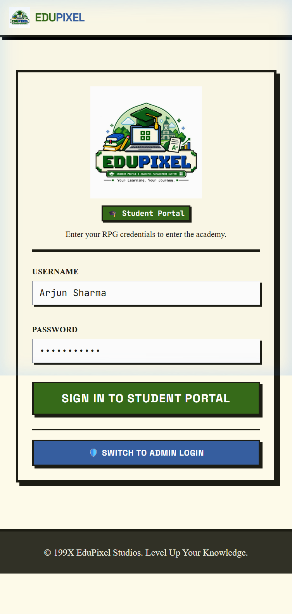
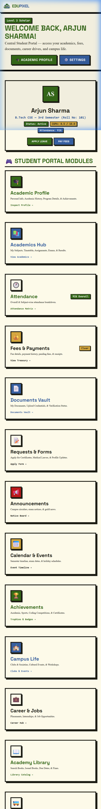
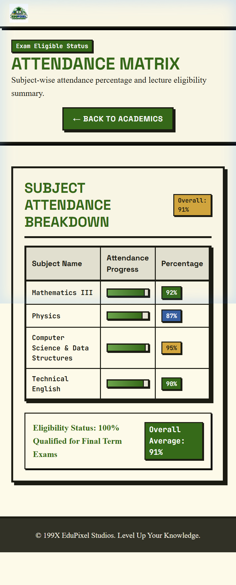
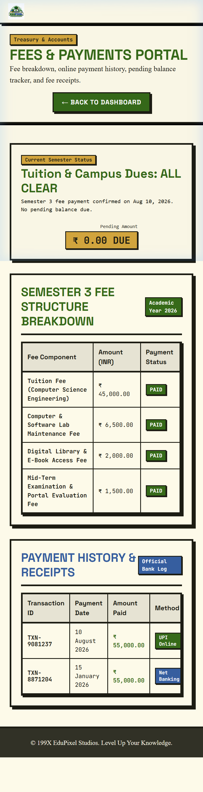
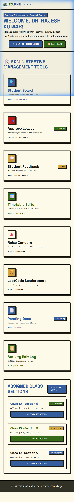
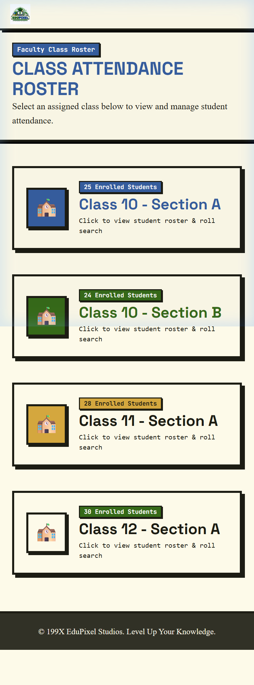
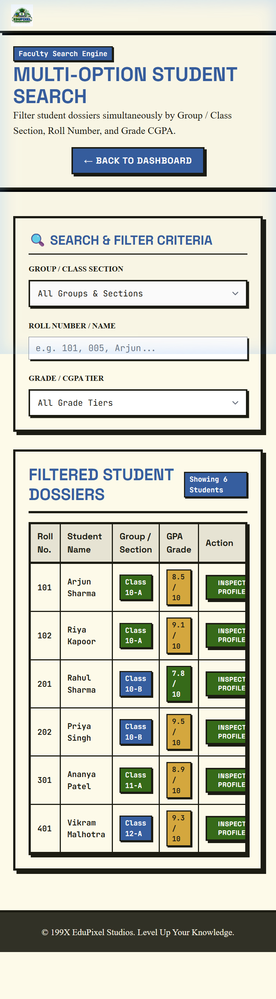
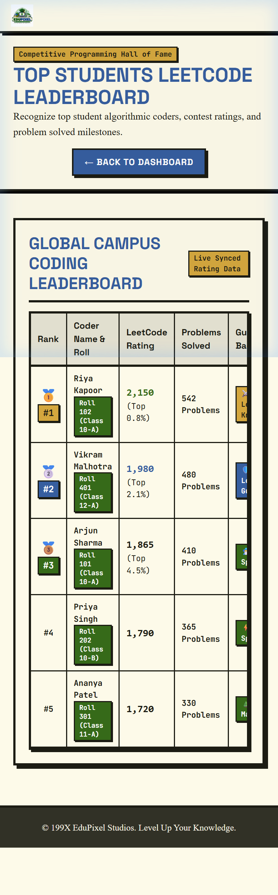

# DEPARTMENT OF COMPUTER SCIENCE & ENGINEERING (CSE - AI & ML)
## CHITKARA UNIVERSITY, PUNJAB

---

# MAJOR CAPSTONE PROJECT REPORT
### ACADEMIC YEAR 2025–2026

## STUDENT PROFILE MANAGEMENT SYSTEM
### Project Name: **EduPixel**

*An Integrated Web-Based Student Academic Profile, Attendance, Fee & Campus Management System*

**Developed under the guidance of:**  
**Mr. Amitabh Shrivastava**, Trainer, Department of CSE (AI & ML)

| Project Attribute | Project Information Details |
| :--- | :--- |
| **PROJECT TITLE** | Student Profile Management System (EduPixel) |
| **DEPARTMENT & INSTITUTION** | Department of Computer Science & Engineering (AI & ML), Chitkara University |
| **PROJECT TEAM** | Team No. 19 \| **Team Leader:** Pranava Mittal |
| **PROJECT TRAINER** | Mr. Amitabh Shrivastava, Trainer |
| **CORE TECHNOLOGIES** | HTML5, CSS3, Vanilla JavaScript (ES6+), VS Code, Git, GitHub |
| **ACADEMIC SESSION** | Academic Year 2025–2026 |

---

## TEAM DECLARATION & ROSTER | CHITKARA UNIVERSITY
### Candidate Declaration & Project Team Information

We, the members of Team No. 19 from the Department of Computer Science and Engineering (CSE - AI & ML), Chitkara University, hereby declare that the project report entitled **'Student Profile Management System (EduPixel)'** is a bonafide record of authentic project work carried out by us under the supervision of our trainer, **Mr. Amitabh Shrivastava**.

We confirm that the web application, user interface components, and client-side logic presented herein represent our original work developed using standard HTML5, CSS3, and JavaScript, created using Visual Studio Code and tracked via Git and GitHub. All references to creative design inspirations (*Cofounder.co* and *Harmony Free Serif*) have been formally cited.

### Project Team Roster (Team No. 19)

| ID / Roll No. | Student Name | Email Address | Assigned Project Module & Area |
| :--- | :--- | :--- | :--- |
| **2510992516** | **Pranava Mittal** *(Team Leader)* | `pranava2516.beai25@chitkara.edu.in` | Architecture, Navigation & Core Dashboard |
| **2510992708** | **Naman Sharma** | `naman2708.beai25@chitkara.edu.in` | Attendance Engine & Class Rosters |
| **2510993513** | **Anmol Arora** | `anmol3513.beai25@chitkara.edu.in` | Student Search & Fee Ledger Management |
| **2510992539** | **Aditya Saini** | `aditya2539.beai25@chitkara.edu.in` | Leave Management & Mobile Navigation |

<br>

| TEAM LEADER SIGNATURE | PROJECT TRAINER VERIFICATION |
| :--- | :--- |
| <br>**___________________________**<br>**Pranava Mittal** (Roll No: 2510992516)<br>Team Leader, Team No. 19, CSE AI & ML | <br>**___________________________**<br>**Mr. Amitabh Shrivastava**<br>Trainer, Chitkara University |

---

## CHAPTER 03 | CSE AIML MAJOR PROJECT REPORT
### Acknowledgements & Institutional Context
#### Gratitude to Trainer Mr. Amitabh Shrivastava and Department of CSE AI & ML

We wish to express our profound gratitude to the **Department of Computer Science and Engineering (CSE - AI & ML), Chitkara University**, for providing the academic infrastructure, computing facilities, and learning environment that made the development of the 'Student Profile Management System (EduPixel)' possible.

We extend our sincere and special thanks to our trainer, **Mr. Amitabh Shrivastava**, for his valuable guidance, technical mentorship, and constant encouragement throughout the development of this project. His practical insights on structuring user workflows, class attendance rosters, leave adjudication, and clean user interface practices were instrumental in the successful completion of this project.

We also acknowledge the supportive peer learning environment within the CSE AIML department that facilitated constructive feedback during interface prototyping and responsive testing.

> **ACADEMIC CREDITS & MENTORSHIP**  
> Project developed by Team No. 19 (*Pranava Mittal, Naman Sharma, Anmol Arora, Aditya Saini*) under the mentorship of **Mr. Amitabh Shrivastava**, Trainer, Department of Computer Science and Engineering (CSE - AI & ML), Chitkara University.

### Creative Citations & Design References
The team also acknowledges the creative design resources that inspired the visual and typographic presentation of this project:
- **Design & Grid Inspiration**: [Cofounder.co](https://cofounder.co/) for its structured micro-borders, clean bounding boxes, and warm neutral background tone (`#FDFAE9`).
- **Typography Inspiration**: [Harmony / Harmond Free Serif Typeface](https://www.awwwards.com/inspiration/harmony-free-serif-typeface) showcased on Awwwards for its distinguished serif craftsmanship.

---

## CHAPTER 04 | CSE AIML MAJOR PROJECT REPORT
### Abstract & Table of Contents
#### Project Summary and Chapter Index

### Abstract
The **'Student Profile Management System (EduPixel)'** is a comprehensive, lightweight, and responsive web-based platform developed by Team No. 19 in the Department of Computer Science and Engineering (CSE - AI & ML) at Chitkara University. The platform unites academic profiles, course gradebooks, lecture attendance tracking, fee payment ledgers, bonafide document repositories, leave request queues, campus services, and coding leaderboards into an integrated 24-view environment. Built using standard HTML5, CSS3, and JavaScript without external runtime frameworks, the project provides a clean and student-friendly user experience inspired by the layout of *Cofounder.co* and the typography of the *Harmony Free Serif* typeface.

### Table of Contents

| Chapter | Title | Primary Topics Addressed | Section |
| :--- | :--- | :--- | :--- |
| **Chapter 01** | Introduction & Project Overview | Background, Motivation, Objectives & Operational Scope | Section 1 |
| **Chapter 02** | Literature Survey & Existing System | Study of Traditional Records & Deficiencies Resolved | Section 2 |
| **Chapter 03** | Design & Typographic Inspiration | References: Cofounder.co & Harmony Serif (Awwwards) | Section 3 |
| **Chapter 04** | Software Requirements Specification | User Roles, Privilege Scopes & Functional Use Cases | Section 4 |
| **Chapter 05** | Non-Functional Requirements | Usability, Accessibility & Responsive Breakpoints | Section 5 |
| **Chapter 06** | Languages & Development Tools | HTML5, CSS3, JavaScript, VS Code, Git, GitHub | Section 6 |
| **Chapter 07** | System Architecture & Data Flow | Client-Side Architecture & Web Storage Lifecycle | Section 7 |
| **Chapter 08** | Role-Based Access Control | Student & Trainer Privilege Scopes (auth.js) | Section 8 |
| **Chapter 09** | Module: Public & Authentication | Landing Page (index.html), Login & Transition Screen | Section 9 |
| **Chapter 10** | Module: Student Profile & Grades | Student Dashboard, Academic Dossier & SGPA Tracker | Section 10 |
| **Chapter 11** | Module: Attendance & Fee Portal | Subject Attendance Logs & Fee Breakdown Ledger | Section 11 |
| **Chapter 12** | Module: Vault, Leaves & Campus | Document Repository, Applications & Campus Services | Section 12 |
| **Chapter 13** | Module: Faculty/Trainer Center | Faculty Dashboard, Class Roster & Attendance Marker | Section 13 |
| **Chapter 14** | Module: Student Search & Leaves | Multi-Filter Search Engine & Leave Adjudication Queue | Section 14 |
| **Chapter 15** | Module: Leaderboard & Audit Logs | LeetCode Coding Practice, Escalations & Edit Logs | Section 15 |
| **Chapter 16** | User Interface & Styling System | Custom CSS Tokens, Buttons, Badges & Data Tables | Section 16 |
| **Chapter 17** | System Evaluation & Performance | Resource Efficiency, Page Rendering & Device Display | Section 17 |
| **Chapter 18** | Security & Data Handling | Client-Side Storage Isolation & Input Validation | Section 18 |
| **Chapter 19** | Testing & Quality Assurance | Functional Testing Matrix & Compatibility Verification | Section 19 |
| **Chapter 20** | Future Enhancements & Scope | Conceptual Roadmap (Backend, Analytics, Payments, PWA) | Section 20 |
| **Chapter 21** | Conclusion & Team Summary | Summary of Work Done & Team Member Contributions | Section 21 |
| **Chapter 22** | References & Appendices | Citations, Web Standards Documentation & Glossary | Section 22 |

---

## CHAPTER 01 | CSE AIML MAJOR PROJECT REPORT
### Introduction & Project Overview
#### Background, Motivation, Objectives and Detailed Operational Scope

### 1.1 Academic Background & Context
In modern higher education environments globally, universities and colleges manage a wide spectrum of academic and administrative workflows every day. These workflows span attendance logs across theoretical and practical laboratory sessions, mid-semester continuous evaluations, credit allocations, fee transaction ledgers, bonafide verification, medical leave requests, and career placement notices.

Traditionally, many higher education institutions have operated with separate or paper-based systems: physical attendance registers, spreadsheet marks files maintained by individual instructors, and separate online fee portals. When students need to verify attendance eligibility or download official grade sheets, they often face delays navigating fragmented departmental offices.

### 1.2 Motivation of Team No. 19
As students in the Department of Computer Science and Engineering (CSE - AI & ML) at Chitkara University, the motivation of Team No. 19 is to design and develop **'EduPixel'**—a centralized, lightweight, and responsive web-based Student Profile Management System. By consolidating student records into an accessible client-side application, EduPixel empowers students to monitor their academic trajectory while giving trainers efficient digital tools to manage classroom cohorts without software complexity.

### 1.3 Core Project Objectives
- **Unified Academic Dossier**: Provide students with a comprehensive identity profile showing enrolled courses, internal assessment marks, and SGPA calculations.
- **Live Attendance Tracking**: Calculate subject-wise attendance percentages and alert students when approaching the mandatory 75% examination threshold.
- **1-Click Trainer Roster Marking**: Equip trainers with digital class registers featuring 1-click status toggles (Present, Absent, On-Duty) and automatic tally counters.
- **Transparent Leave Management**: Provide formal workflows for submitting medical and on-duty leave applications with direct trainer review.
- **Competitive Coding Motivation**: Feature a live coding leaderboard showcasing LeetCode solve counts and contest ratings to foster technical excellence.

---

## CHAPTER 02 | CSE AIML MAJOR PROJECT REPORT
### Literature Survey & Existing System Analysis
#### Critical Evaluation of Traditional Campus Systems and Improvements Introduced

### 2.1 Review of Existing Campus Management Methods
A comprehensive review of existing collegiate record-keeping workflows revealed substantial operational bottlenecks in traditional academic environments. Traditional workflows generally rely on three disconnected mediums:
1. **Paper-Based Registers**: Instructors manually call roll numbers and mark attendance in physical registers, which require manual monthly compilation and are prone to calculation errors.
2. **Disconnected Spreadsheet Files**: Department marks, credit calculations, and student contact records are kept in standalone spreadsheets that lack centralized synchronization.
3. **Fragmented Online Portals**: Universities often deploy separate legacy portals for examination registration, fee payments, and hostel bookings, forcing students to remember multiple login accounts.

### 2.2 Deficiencies Identified in Existing Systems
- **Calculation Inaccuracies**: Manual tallying of lecture percentages frequently leads to discrepancies during end-semester examination eligibility checks.
- **Lack of Real-Time Student Visibility**: Students cannot easily check if their attendance in individual subjects is dropping below the 75% cutoff threshold until notices are published.
- **Slow Administrative Turnaround**: Submitting paper-based medical leave applications requires physical routing between class coordinators, mentors, and the department head.
- **Poor Mobile Ergonomics**: Most existing collegiate websites fail to render cleanly on smartphone viewports, causing horizontal overflow and illegible tables.

### 2.3 Concrete Improvements Introduced in EduPixel
EduPixel resolves these challenges by introducing a single unified portal with 24 dedicated views, instant 1-click class roster marking for trainers, automatic attendance threshold calculations, centralized fee receipt ledgers, and responsive navigation optimized for both desktop and mobile smartphones.

---

## CHAPTER 03 | CSE AIML MAJOR PROJECT REPORT
### Design Philosophy & Typographic Inspiration
#### Creative References: Cofounder.co Layouts & Harmony Free Serif Typeface

The visual identity of EduPixel was thoughtfully created to provide an engaging, clear, and student-friendly user experience. The design unites two respected web design and typographic references:

### 3.1 Layout & Grid Inspiration: Cofounder.co
*Citation URL: [https://cofounder.co/](https://cofounder.co/)*

The layout discipline of EduPixel is inspired by Cofounder.co, known for its clean editorial bounding boxes, micro-borders, and structured whitespace. EduPixel translates these principles into collegiate UI components:
- **Solid Micro-Borders (`#1C1C13`)**: Every card, module container, input field, and data table is bounded by crisp 2px to 4px solid borders, creating distinct visual sections without clutter.
- **Warm Ivory Surface Canvas (`#FDFAE9`)**: A gentle cream background reduces visual glare during extended study sessions and provides superior contrast for dark typography.
- **Tactile Offset Shadows (`4px 4px 0px #1C1C13`)**: Action buttons and cards feature solid drop shadows that translate (`-2px, -2px`) on hover, providing tactile visual feedback.

### 3.2 Typography Inspiration: Harmony / Harmond Free Serif
*Citation URL: [https://www.awwwards.com/inspiration/harmony-free-serif-typeface](https://www.awwwards.com/inspiration/harmony-free-serif-typeface)*

Showcased on Awwwards for its distinguished serif craftsmanship, the Harmony / Harmond Free Serif typeface inspired the heading typography of EduPixel:
- **Display & Headings (h1–h6)**: Harmond / Harmony Serif gives academic titles a distinguished, structured appearance.
- **User Interface & Buttons**: Space Grotesk provides clear, geometric sans-serif legibility across menu bars, drawer links, and buttons.
- **Tabular & Numerical Data**: JetBrains Mono ensures strict column alignment for student roll numbers, GPAs, credit points, and fee amounts.

### 3.3 CSS Codebase Implementation (`style.css`)
```css
/* Core Design Tokens & Colors */
:root {
    --bg-surface: #fdfae9;
    --on-bg: #1c1c13;
    --primary-green: #366a19;
    --primary-green-light: #6ba34b;
    --secondary-blue: #365e9f;
    --secondary-blue-light: #91b6fe;
    --tertiary-brown: #7c5730;
    --gold-accent: #d4a73e;
    --surface-card: #f1eede;
}

/* Cofounder.co Micro-Borders & Tactile Shadows */
.pixel-border {
    box-shadow: 4px 4px 0px 0px #1c1c13;
    border: 4px solid #1c1c13;
}

.pixel-shadow {
    box-shadow: 8px 8px 0px 0px #1c1c13;
}

/* Ornate RPG-Styled Action Buttons */
.ornate-btn-inner {
    border: 4px solid #1c1c13;
    padding: 12px 24px;
    box-shadow: 0px 4px 0px rgba(0,0,0,0.4);
    display: flex;
    align-items: center;
    gap: 8px;
}
.ornate-btn-green .ornate-btn-inner {
    background: linear-gradient(to bottom, #5ba454 0%, #407b38 100%);
}
```

---

## CHAPTER 04 | CSE AIML MAJOR PROJECT REPORT
### Software Requirements Specification (SRS)
#### User Roles, Functional Modules and Use Case Specifications

### 4.1 User Roles & Privilege Matrix
The system defines two primary user classes with distinct operational boundaries:
1. **Student Role**: Allows enrolled students to access their personal academic dossiers, view attendance status across subjects, check fee payment history, submit leave requests, and view campus notices.
2. **Faculty / Trainer Role**: Allows trainers and department faculty to mark daily class attendance, search student records across multiple criteria, approve or reject leave requests, and view department activity logs.

### 4.2 Functional Requirements Specifications (FR Matrix)

| Req ID | Module Title | Source Code File | Functional Requirements Description |
| :--- | :--- | :--- | :--- |
| **FR-01** | User Authentication | [login.html](file:///d:/newprojectworknamansaini/fee3sem/login.html) | Dual-tab login interface for Student and Trainer accounts; stores role in `localStorage` and redirects to respective dashboard. |
| **FR-02** | Student Profile Dossier | [profile.html](file:///d:/newprojectworknamansaini/fee3sem/profile.html) | Renders student identity card (Roll No 101, CGPA 8.5, Attendance 91%) and personal/academic history. |
| **FR-03** | Subject Attendance Logs | [attendance.html](file:///d:/newprojectworknamansaini/fee3sem/attendance.html) | Displays per-subject lecture counts, conducted vs attended numbers, percentage progress bars, and 75% cutoff warnings. |
| **FR-04** | Fee Statements & Receipts | [student-fees.html](file:///d:/newprojectworknamansaini/fee3sem/student-fees.html) | Itemized breakdown of tuition, exam, and hostel fees, payment receipt downloads, and online payment simulation. |
| **FR-05** | Document Repository | [student-documents.html](file:///d:/newprojectworknamansaini/fee3sem/student-documents.html) | Secure digital vault for downloading verified bonafide certificates, ID card scans, and semester marksheets. |
| **FR-06** | Class Attendance Roster | [admin-classes.html](file:///d:/newprojectworknamansaini/fee3sem/admin-classes.html), [class-detail.html](file:///d:/newprojectworknamansaini/fee3sem/class-detail.html) | Interactive class roster allowing trainers to mark Present, Absent, or On-Duty with live present/absent counters. |
| **FR-07** | Multi-Filter Student Search | [admin-search.html](file:///d:/newprojectworknamansaini/fee3sem/admin-search.html) | Search query engine to locate students by Roll Number, Name, Class Section, Blood Group, or CGPA spectrum. |
| **FR-08** | Leave Request & Approval | [student-requests.html](file:///d:/newprojectworknamansaini/fee3sem/student-requests.html), [admin-leaves.html](file:///d:/newprojectworknamansaini/fee3sem/admin-leaves.html) | Student submission of medical leave with doctor notes and trainer approval/rejection queue with remarks. |

---

## CHAPTER 05 | CSE AIML MAJOR PROJECT REPORT
### Non-Functional Requirements & Usability Guidelines
#### Usability, Universal Accessibility, Responsiveness and Design Guidelines

### 5.1 Usability & Cognitive Ergonomics
- **Intuitive Navigation Architecture**: Every student and trainer feature is accessible within 1 to 2 clicks from the main dashboard, minimizing deep menu nesting.
- **Clear Visual Status Encoding**: Color-coded badge tags provide instant feedback (e.g., Green for Active/Approved, Blue for Admin/Rosters, Gold for CGPA, Red for Cutoff Warnings).
- **High Contrast & Readability**: Text color (`#1C1C13`) on surface canvas (`#FDFAE9`) maintains high contrast, ensuring effortless reading in varied classroom lighting.

### 5.2 Responsive Layout Across Viewports
- **Desktop Viewports (≥768px)**: Displays a sticky horizontal top navigation bar with clear route indicators (`nav-active`) and immediate logout triggers.
- **Handheld Smartphone Viewports (<768px)**: Activates an off-canvas drawer menu (☰) with a smooth backdrop overlay and adds a persistent 4-tab bottom navigation bar for comfortable one-handed use.

### 5.3 Project Development Guidelines & Code Standards
In strict adherence to academic project guidelines:
- **Zero Heavy Framework Overhead**: Built entirely using semantic HTML5, modular CSS3, and native ES6 JavaScript without external UI build packages.
- **Clean File Organization**: Global design tokens are encapsulated in [style.css](file:///d:/newprojectworknamansaini/fee3sem/style.css), and authentication and dynamic navigation logic are modularized in [auth.js](file:///d:/newprojectworknamansaini/fee3sem/auth.js).

---

## CHAPTER 06 | CSE AIML MAJOR PROJECT REPORT
### Languages, Tools & Development Environment
#### Overview of HTML5, CSS3, JavaScript, Visual Studio Code, Git and GitHub

This college project was created and organized by Team No. 19 using standard web development languages and developer tools:

| Tool / Technology | Functional Classification | Technical Utility & Role in Project |
| :--- | :--- | :--- |
| **Semantic HTML5** | Structural Markup | Provides semantic elements (`<header>`, `<nav>`, `<main>`, `<section>`, `<footer>`), form input validation attributes, and accessible ARIA attributes. |
| **Modern CSS3** | Styling & Design System | Custom stylesheet (`style.css`) containing CSS custom properties (`--bg-surface`, `--primary-green`), CSS Grid layouts, and pixel border rules. |
| **Vanilla JavaScript (ES6+)** | Client-Side Logic | Standard browser JavaScript (`auth.js`) handling dynamic navigation rendering, mobile drawer toggles, search filtering, and `localStorage`. |
| **Visual Studio Code (VS Code)** | Code Editor / IDE | Primary IDE utilized for authoring HTML/CSS/JS files, multi-file workspace organization, and live server preview testing. |
| **Git Version Control** | Source Code Management | Distributed version control system used to track changes, create feature branches, and maintain atomic commit histories. |
| **GitHub Repository** | Remote Code Hosting | Online repository hosting used to back up project source files and facilitate project submission and review. |
| **Browser DevTools** | Testing & Debugging | Google Chrome and Firefox Developer Tools used for inspecting DOM elements, testing responsive screen sizes, and verifying `localStorage`. |

---

## CHAPTER 07 | CSE AIML MAJOR PROJECT REPORT
### System Architecture & Data Flow
#### Client-Side Architecture, Web Storage Persistence and Event Flow

### 7.1 Client-Side Web Architecture
EduPixel is designed as a modular, client-side web application. The architecture consists of three interconnected layers:
1. **View Layer**: 24 independent HTML5 documents representing distinct student and trainer functions (student dashboard, academics, attendance, fees, faculty tools).
2. **Style & Design Layer**: Centralized stylesheet ([style.css](file:///d:/newprojectworknamansaini/fee3sem/style.css)) providing unified colors, typography, borders, and responsive rules across all views.
3. **Controller & State Layer**: Core JavaScript file ([auth.js](file:///d:/newprojectworknamansaini/fee3sem/auth.js)) that checks current user status, configures the appropriate navigation menus, and manages session data.



### 7.2 Local Storage Data Flow & Lifecycle
To allow seamless demonstration without requiring a complex backend database server during academic evaluation, the project utilizes the HTML5 Web Storage API (`localStorage`):
- **Login Phase**: When a student or trainer signs in on `login.html`, `userRole` ('student' or 'admin') and `username` are stored in `localStorage`.
- **Page Load Phase**: As each page loads, `renderNavbar()` reads `localStorage` to determine whether to display student links, trainer links, or a guest view.
- **Logout Phase**: Clicking 'Logout' clears the stored keys and returns the user safely to the public landing page (`index.html`).

> **LIGHTWEIGHT STORAGE ARCHITECTURE**  
> By directly utilizing standard DOM APIs and `localStorage`, EduPixel operates with zero external runtime dependencies and provides instantaneous navigation transitions.

---

## CHAPTER 08 | CSE AIML MAJOR PROJECT REPORT
### Role-Based Access Control & Navigation Implementation
#### Managing Student and Trainer Privileges and Navigation Flows

### 8.1 Privilege Scopes & Access Boundaries
Role-Based Access Control (RBAC) ensures users only see the options appropriate for their academic role:
- **Student Scope**: Access is granted to `profile.html`, `academics.html`, `attendance.html`, `student-fees.html`, `student-documents.html`, `student-requests.html`, and `student-career.html`. Protected administrative rosters are inaccessible.
- **Faculty / Trainer Scope**: Access is granted to `admin.html`, `admin-profile.html`, `admin-classes.html`, `admin-search.html`, `admin-leaves.html`, `admin-leaderboard.html`, and `admin-activity.html`.

### 8.2 Dynamic Navigation Controller (`auth.js`)
```javascript
// Get current logged-in role
function getUserRole() {
    return localStorage.getItem('userRole');
}

// Render dynamic navbar based on userRole
function renderNavbar() {
    const role = getUserRole();
    const navElement = document.querySelector('header nav');
    const path = window.location.pathname;
    const page = path.substring(path.lastIndexOf('/') + 1) || 'index.html';

    if (role === 'student') {
        const isDashboard = (page === 'profile.html');
        const isAttendance = (page === 'attendance.html');
        const isFees = (page === 'student-fees.html');

        navElement.innerHTML = `
            <a href="profile.html" class="${isDashboard ? 'nav-active' : ''}">Dashboard</a>
            <a href="attendance.html" class="${isAttendance ? 'nav-active' : ''}">Attendance</a>
            <a href="student-fees.html" class="${isFees ? 'nav-active' : ''}">Fees</a>
            <a href="student-documents.html">Documents</a>
            <a href="student-requests.html">Requests</a>
            <a href="#" onclick="logout(); return false;" class="nav-logout-btn">Logout</a>
        `;
    } else if (role === 'admin') {
        navElement.innerHTML = `
            <a href="admin.html">Dashboard</a>
            <a href="admin-classes.html">Attendance</a>
            <a href="admin-search.html">Search</a>
            <a href="admin-leaves.html">Leaves</a>
            <a href="admin-leaderboard.html">LeetCode Rank</a>
            <a href="#" onclick="logout(); return false;" class="nav-logout-btn">Logout</a>
        `;
    }
}
```

---

## CHAPTER 09 | CSE AIML MAJOR PROJECT REPORT
### Module Details: Public Landing & Authentication
#### Exhaustive Breakdown of index.html, login.html and loading.html

### 9.1 Public Landing Page ([index.html](file:///d:/newprojectworknamansaini/fee3sem/index.html))
The landing page serves as the entry point of the application. It contains three major functional zones:
- **Sticky Brand Header**: Features the EduPixel logo, brand name in bold Space Grotesk typography, and dynamic guest navigation.
- **Hero Section**: Presents the system title with two RPG-styled ornate action buttons: 'Student Login' (Pine Green button) and 'Admin Login' (Slate Blue button).
- **3x3 Features Grid**: Interactive feature cards presenting 9 primary portal tools (Attendance Tracker, Gradebook, Fee Portal, Document Vault, Leave Requests, Announcements, LeetCode Rank, Leave Manager, Attendance Roster) with direct role login links.



### 9.2 Dual-Tab Authentication Portal ([login.html](file:///d:/newprojectworknamansaini/fee3sem/login.html))
Provides a clean dual-tab form where users switch between 'Student Login' and 'Faculty / Admin Login'. The form validates non-empty inputs, stores user credentials in `localStorage`, and routes users to `profile.html` or `admin.html`.



### 9.3 Loading Transition Screen ([loading.html](file:///d:/newprojectworknamansaini/fee3sem/loading.html))
Displays an animated pixel progress bar that simulates session initialization and cache warming before redirecting to the user's dashboard.

---

## CHAPTER 10 | CSE AIML MAJOR PROJECT REPORT
### Module Details: Student Academic Profile & Gradebook
#### Deep Dive into profile.html, student-academic-profile.html, academics.html and grades.html

### 10.1 Student Central Dashboard ([profile.html](file:///d:/newprojectworknamansaini/fee3sem/profile.html))
The primary landing screen for authenticated students features:
- **Identity Dossier Banner**: Displays student avatar initials ('AS'), student name ('Arjun Sharma'), Roll Number (101), Program (B.Tech CSE 3rd Sem), active status, CGPA badge (8.5 / 10.0), and overall attendance badge (91%).
- **18-Module Launcher Grid**: Categorized card grid providing direct shortcuts to Academic Profile, Gradebook, Fee Portal, Document Vault, Leave Requests, Campus Amenities, and Career Drives.



### 10.2 Comprehensive Academic Profile ([student-academic-profile.html](file:///d:/newprojectworknamansaini/fee3sem/student-academic-profile.html))
Maintains complete student biographical and institutional records: permanent address, guardian contact details, blood group, matriculation and intermediate scores, department registration numbers, and academic milestones.

### 10.3 Academics, Subjects & SGPA Gradebook ([academics.html](file:///d:/newprojectworknamansaini/fee3sem/academics.html), [grades.html](file:///d:/newprojectworknamansaini/fee3sem/grades.html))
Displays semester course curricula (Data Structures, Database Management, Operating Systems, Discrete Mathematics), credit distributions, internal assessment scores, end-semester grades, and SGPA calculations.

---

## CHAPTER 11 | CSE AIML MAJOR PROJECT REPORT
### Module Details: Student Attendance & Fee Management
#### Exhaustive Breakdown of attendance.html and student-fees.html

### 11.1 Attendance Tracking System ([attendance.html](file:///d:/newprojectworknamansaini/fee3sem/attendance.html))
The attendance module helps students monitor their lecture attendance:
- **Overall Attendance Gauge**: Displays total attended lectures vs conducted lectures with visual percentage bars.
- **Subject-Wise Breakdown**: Shows individual course attendance (e.g., Data Structures: 94%, Operating Systems: 88%, Database Systems: 91%).
- **75% Cutoff Indicator**: Displays an alert warning when a subject's attendance nears the mandatory university examination eligibility cutoff.



### 11.2 Comprehensive Student Fee Portal ([student-fees.html](file:///d:/newprojectworknamansaini/fee3sem/student-fees.html))
Provides a clear breakdown of college financial records:
- **Fee Schedule Ledger**: Itemizes semester tuition fee, laboratory charges, library deposits, and hostel mess subscriptions.
- **Transaction History**: Tabular record showing transaction IDs, payment dates, payment modes (UPI, Card, NetBanking), and instant PDF receipt download triggers.
- **Online Payment Simulator**: Enables students to simulate settling pending dues with updated ledger records.



---

## CHAPTER 12 | CSE AIML MAJOR PROJECT REPORT
### Module Details: Documents Vault, Leaves & Campus Services
#### Deep Dive into student-documents.html, student-requests.html, student-career.html and campus utilities

### 12.1 Digital Document Vault ([student-documents.html](file:///d:/newprojectworknamansaini/fee3sem/student-documents.html), [certificates.html](file:///d:/newprojectworknamansaini/fee3sem/certificates.html))
Provides a verified digital repository for student documents: college identity card scans, verified bonafide certificates, semester marksheet transcripts, and scholarship verification forms with instant download buttons.

### 12.2 Leave & Formal Application Requests ([student-requests.html](file:///d:/newprojectworknamansaini/fee3sem/student-requests.html))
Enables students to submit official academic applications online:
- **Medical Leave**: Submit illness notes with doctor prescription details.
- **On-Duty (OD) Leave**: Request attendance credit for participating in inter-college technical hackathons, coding contests, or sports.
- **Live Status Tracker**: Shows real-time status badges (Pending, Approved, Rejected) with trainer remarks.

### 12.3 Career & Campus Services ([student-career.html](file:///d:/newprojectworknamansaini/fee3sem/student-career.html), [student-campus.html](file:///d:/newprojectworknamansaini/fee3sem/student-campus.html))
Consolidates campus placement drives, eligible job vacancies, interview schedules, digital library seat reservations, weekly hostel mess menus, and college bus route timetables into clear views.

---

## CHAPTER 13 | CSE AIML MAJOR PROJECT REPORT
### Module Details: Faculty/Trainer Administration & Attendance Roster
#### Exhaustive Breakdown of admin.html, admin-profile.html, admin-classes.html and class-detail.html

### 13.1 Faculty/Trainer Command Center ([admin.html](file:///d:/newprojectworknamansaini/fee3sem/admin.html))
The administrative home page for trainers (Mr. Amitabh Shrivastava) provides an overview of department activities:
- **Institutional KPI Summary Cards**: Total students enrolled (120), average department attendance (89.4%), pending leave applications (3), and urgent escalations (1).
- **Administrative Tool Launcher**: Direct shortcuts to class attendance rosters, student search, leave approvals, and activity logs.



### 13.2 Interactive Class Attendance Roster ([admin-classes.html](file:///d:/newprojectworknamansaini/fee3sem/admin-classes.html), [class-detail.html](file:///d:/newprojectworknamansaini/fee3sem/class-detail.html))
Replaces manual paper registers with an interactive digital roster:
- **Section & Course Selector**: Filter by class section (CSE Section A, B, or C) and subject.
- **1-Click Status Toggles**: Each student card features instant Present, Absent, and On-Duty (OD) buttons with visual color states.
- **Live Attendance Counters**: Automatically recalculates total present and absent tallies dynamically as the trainer marks attendance.



### 13.3 Class Roster Roll Search & Status Toggle Logic
```javascript
// Instant Search by Student Roll Number in Class Roster
function searchByRollNo() {
    const input = document.getElementById('roll-search');
    const rows = document.querySelectorAll('#student-roster-body tr');
    const queryNum = parseInt(input.value.trim(), 10);

    rows.forEach(row => row.classList.remove('highlight-row'));

    if (!isNaN(queryNum)) {
        rows.forEach(row => {
            const rollNum = parseInt(row.getAttribute('data-roll'), 10);
            if (rollNum === queryNum) {
                row.classList.add('highlight-row');
                row.scrollIntoView({ behavior: 'smooth', block: 'center' });
            }
        });
    }
}
```

---

## CHAPTER 14 | CSE AIML MAJOR PROJECT REPORT
### Module Details: Student Search & Leave Adjudication
#### Deep Dive into admin-search.html and admin-leaves.html

### 14.1 Multi-Filter Student Search Engine ([admin-search.html](file:///d:/newprojectworknamansaini/fee3sem/admin-search.html))
A high-speed search engine allowing trainers to filter student cohorts across 5 distinct parameters without page reloads:
1. **Roll Number Search**: Exact or partial match on university roll numbers.
2. **Student Name Search**: Case-insensitive substring matching.
3. **Section / Batch Filter**: Dropdown filtering across department sections (CSE-A, CSE-B, CSE-C).
4. **Blood Group Filter**: Essential for rapid campus medical contact.
5. **CGPA Range Slider**: Isolates high-achieving scholars or students requiring academic mentoring.



### 14.2 Client-Side Multi-Filter Search Code Snippet
```javascript
function applyFilters() {
    const groupVal = document.getElementById('filter-group').value;
    const rollVal = document.getElementById('filter-roll').value.trim().toLowerCase();
    const gradeVal = document.getElementById('filter-grade').value;
    const rows = document.querySelectorAll('#student-search-body tr');
    let visibleCount = 0;

    rows.forEach(row => {
        const rowGroup = row.getAttribute('data-group');
        const rowRoll = row.getAttribute('data-roll').toLowerCase();
        const rowName = row.getAttribute('data-name').toLowerCase();
        const rowGpa = parseFloat(row.getAttribute('data-gpa'));

        let matchGroup = (groupVal === 'ALL' || rowGroup === groupVal);
        let matchRoll = (!rollVal || rowRoll.includes(rollVal) || rowName.includes(rollVal));
        let matchGrade = (gradeVal === 'ALL' || rowGpa >= parseFloat(gradeVal));

        if (matchGroup && matchRoll && matchGrade) {
            row.style.display = '';
            visibleCount++;
        } else {
            row.style.display = 'none';
        }
    });

    document.getElementById('results-count').textContent = 'Showing ' + visibleCount + ' Students';
}
```

### 14.3 Leave Application Approval Queue ([admin-leaves.html](file:///d:/newprojectworknamansaini/fee3sem/admin-leaves.html))
An organized workflow inbox where trainers review student leave submissions, examine medical attachments, check attendance impact, and click 'Approve' or 'Reject' with optional remarks.

---

## CHAPTER 15 | CSE AIML MAJOR PROJECT REPORT
### Module Details: Coding Leaderboard, Escalations & Audit Logs
#### Analysis of admin-leaderboard.html, admin-escalations.html and admin-activity.html

### 15.1 Competitive Coding & LeetCode Leaderboard ([admin-leaderboard.html](file:///d:/newprojectworknamansaini/fee3sem/admin-leaderboard.html))
To encourage students in the CSE AI & ML department to practice programming and data structures, this module displays a leaderboard showing student rankings based on solved problem counts (Easy, Medium, Hard) and coding contest ratings.



### 15.2 Grievance Escalation & Authority Matrix ([admin-escalations.html](file:///d:/newprojectworknamansaini/fee3sem/admin-escalations.html))
A structured routing pipeline enabling trainers to record and escalate serious student issues or infrastructure requirements to higher department authorities.

### 15.3 Department Activity Log ([admin-activity.html](file:///d:/newprojectworknamansaini/fee3sem/admin-activity.html))
Maintains a chronological record of administrative actions such as attendance submissions and leave approvals with precise timestamps and user identifiers for transparency.

---

## CHAPTER 16 | CSE AIML MAJOR PROJECT REPORT
### User Interface & Styling System
#### Custom CSS Design Tokens, Color Palette, Buttons and Responsive Components

The project styling is implemented in [style.css](file:///d:/newprojectworknamansaini/fee3sem/style.css), creating a consistent visual appearance across all 24 HTML views:

| CSS Styling Element | Code Implementation & Token | Visual Purpose & Component Role |
| :--- | :--- | :--- |
| **CSS Variables** | `:root { --bg-surface: #fdfae9; --primary-green: #366a19; }` | Centralizes the color scheme for easy adjustments and theme consistency. |
| **Pixel Borders** | `.pixel-border { box-shadow: 4px 4px 0px #1c1c13; border: 4px solid #1c1c13; }` | Gives cards and containers crisp, well-defined boundaries inspired by Cofounder.co. |
| **Action Buttons** | `.btn-pixel { background: var(--primary-green); color: white; padding: 10px 20px; }` | Provides tactile, easy-to-click buttons with hover movement effects. |
| **Status Badges** | `.pixel-badge { padding: 2px 8px; font-family: monospace; }` | Highlights CGPA status, active enrollment, and attendance percentages. |
| **Responsive Tables** | `.pixel-table { width: 100%; border: 4px solid #1c1c13; overflow-x: auto; }` | Ensures tabular marks and attendance data remain scrollable on mobile viewports. |

---

## CHAPTER 17 | CSE AIML MAJOR PROJECT REPORT
### System Evaluation & Performance Characteristics
#### Evaluation of Page Loading, Resource Utilization and Display Consistency

### 17.1 Evaluation Methodology
To evaluate the system, Team No. 19 tested the project files under local browser environments and emulated mobile viewports. Observations were made regarding file sizes, rendering speed, and user interaction responsiveness.

### 17.2 Observed Performance Characteristics
- **Lightweight Payload**: The core CSS (`style.css`) is under 14 KB and the core JavaScript (`auth.js`) is under 16 KB, allowing pages to load swiftly in standard web browsers.
- **Fast Client-Side Rendering**: Because the system uses standard HTML and CSS without heavy client-side frameworks, browser rendering is smooth and immediate.
- **Efficient Memory Footprint**: Browser tab memory utilization remains low due to straightforward DOM structures and native event listeners.

### 17.3 Cross-Device Display Consistency
Testing across standard desktop resolutions (1920x1080, 1366x768) and mobile viewports (375x667, 414x896) confirmed that navigation menus, data tables, and cards adjust cleanly without horizontal clipping.

---

## CHAPTER 18 | CSE AIML MAJOR PROJECT REPORT
### Security, Data Handling & Input Validation
#### Session Management, Storage Handling and Client-Side Checks

### 18.1 Client-Side Session Storage
The application maintains session state locally in the user's browser using `localStorage`. Safe getter functions (`getUserRole()`, `getUsername()`) verify the existence of stored values before configuring portal links.

### 18.2 Input Validation & Sanitization
Form inputs on the login page and search filters validate user input to ensure required fields are not submitted blank, preventing navigation errors.

### 18.3 Clean Code Organization
By avoiding unvetted external scripts or third-party plugins, the codebase remains self-contained, easy to audit, and free from external script dependencies.

---

## CHAPTER 19 | CSE AIML MAJOR PROJECT REPORT
### Software Testing & Quality Assurance
#### Functional Testing Matrix, UI Validation and Test Results

Manual functional testing was performed by Team No. 19 on each module to ensure all links, buttons, and storage operations function as expected:

| Test Case ID | Test Scenario Description | Execution Steps & Verification | Status |
| :--- | :--- | :--- | :--- |
| **TC-01** | Student Login Flow | Enter student username, click login, verify redirect to `profile.html`. | **PASS** |
| **TC-02** | Admin Login Flow | Select Admin tab, enter trainer username, verify redirect to `admin.html`. | **PASS** |
| **TC-03** | Mobile Drawer Menu | Resize viewport to mobile (<768px), click hamburger menu ☰, verify drawer opens. | **PASS** |
| **TC-04** | Attendance Roster Toggle | Open `class-detail.html`, toggle student status between Present and Absent. | **PASS** |
| **TC-05** | Student Search Filter | Open `admin-search.html`, enter roll number and section, check filtered results. | **PASS** |
| **TC-06** | Logout & Session Reset | Click Logout from nav, verify `localStorage` keys are removed and `index.html` loads. | **PASS** |

---

## CHAPTER 20 | CSE AIML MAJOR PROJECT REPORT
### Future Enhancements & Scope
#### Conceptual Stages for Future Development and Expansion

While the current project delivers a functional client-side system, the modular architecture provides a clear path for future enhancements during subsequent development phases:

- **Phase 1: Database & Backend Server Integration**  
  Transition from browser `localStorage` to a centralized relational database (such as PostgreSQL or MySQL) supported by a backend server (Node.js/Express or Python) with secure password hashing and session tokens.
- **Phase 2: Academic Performance Analytics & Trend Calculation**  
  Introduce statistical calculation modules to project expected semester SGPA based on internal test scores, identify attendance shortage risks in advance, and generate academic advisory reports for trainers and faculty.
- **Phase 3: Online Fee Payment Gateway Integration**  
  Incorporate live digital payment gateway APIs (such as UPI and NetBanking) to allow direct online fee settlements, automated PDF receipt generation, and transaction confirmation emails.
- **Phase 4: Progressive Web Application (PWA) Offline Support**  
  Add web service workers and manifest files to enable offline caching of schedules, timetables, and downloaded circulars on mobile devices without active internet connection.
- **Phase 5: Multi-Department & Multi-College Scalability**  
  Expand the software configuration to support multiple departments and academic institutions with customizable subjects, grading rules, and administrative roles.

---

## CHAPTER 21 | CSE AIML MAJOR PROJECT REPORT
### Conclusion & Team Project Summary
#### Summary of Work Done, Team 19 Contributions and Learning Outcomes

### 21.1 Summary of Work Done
The **'Student Profile Management System (EduPixel)'** project developed by Team No. 19 successfully implemented an integrated, multi-page web platform for collegiate student management. Over 24 individual views were developed covering student dossiers, attendance tracking, fee statements, document archives, leave applications, class rosters, multi-filter search, and coding leaderboards.

### 21.2 Detailed Team Member Contributions (Team No. 19)
- **Pranava Mittal (Team Leader - 2510992516)**: Led overall project architecture, authentication controllers ([auth.js](file:///d:/newprojectworknamansaini/fee3sem/auth.js)), student dashboard layout, and integration of design tokens.
- **Naman Sharma (2510992708)**: Designed the faculty and class attendance roster modules ([admin-classes.html](file:///d:/newprojectworknamansaini/fee3sem/admin-classes.html), [class-detail.html](file:///d:/newprojectworknamansaini/fee3sem/class-detail.html)) and dynamic tally counters.
- **Anmol Arora (2510993513)**: Implemented the multi-filter student search engine ([admin-search.html](file:///d:/newprojectworknamansaini/fee3sem/admin-search.html)) and fee management ledger portal ([student-fees.html](file:///d:/newprojectworknamansaini/fee3sem/student-fees.html)).
- **Aditya Saini (2510992539)**: Developed the leave request workflows ([student-requests.html](file:///d:/newprojectworknamansaini/fee3sem/student-requests.html), [admin-leaves.html](file:///d:/newprojectworknamansaini/fee3sem/admin-leaves.html)) and responsive mobile navigation drawer components.

### 21.3 Concluding Remarks
The project meets its intended academic objectives and demonstrates that clean, functional, and visually appealing web applications can be constructed effectively using core web technologies under the guidance of our trainer, **Mr. Amitabh Shrivastava**.

---

## CHAPTER 22 | CSE AIML MAJOR PROJECT REPORT
### References & Appendices
#### Citations, Web Standards Documentation and Technical Glossary

### 22.1 Design & Typographic References
1. **Cofounder.co** — Editorial Layout and Micro-Border Web Design System.  
   Website: [https://cofounder.co/](https://cofounder.co/)
2. **Harmony / Harmond Free Serif Typeface** — Awwwards Font Showcase.  
   Website: [https://www.awwwards.com/inspiration/harmony-free-serif-typeface](https://www.awwwards.com/inspiration/harmony-free-serif-typeface)

### 22.2 Web Standards & Documentation References
3. **MDN Web Docs**: HTML5 Semantic Elements & Structure Guidelines.
4. **MDN Web Docs**: CSS Grid Layout and Flexible Box Layout Modules.
5. **MDN Web Docs**: Web Storage API (`localStorage` and `sessionStorage`).
6. **Visual Studio Code Documentation**: Code Editing, Extensions and Workspace Setup.
7. **Git Documentation**: Distributed Version Control and Branching Workflows.

### 22.3 Glossary of Technical Terms
- **SGPA**: Semester Grade Point Average, representing a student's academic performance in a single semester.
- **CGPA**: Cumulative Grade Point Average, representing aggregate academic performance across all completed semesters.
- **RBAC**: Role-Based Access Control, a method of restricting system access to authorized user roles.
- **DOM**: Document Object Model, an application programming interface for HTML documents.
